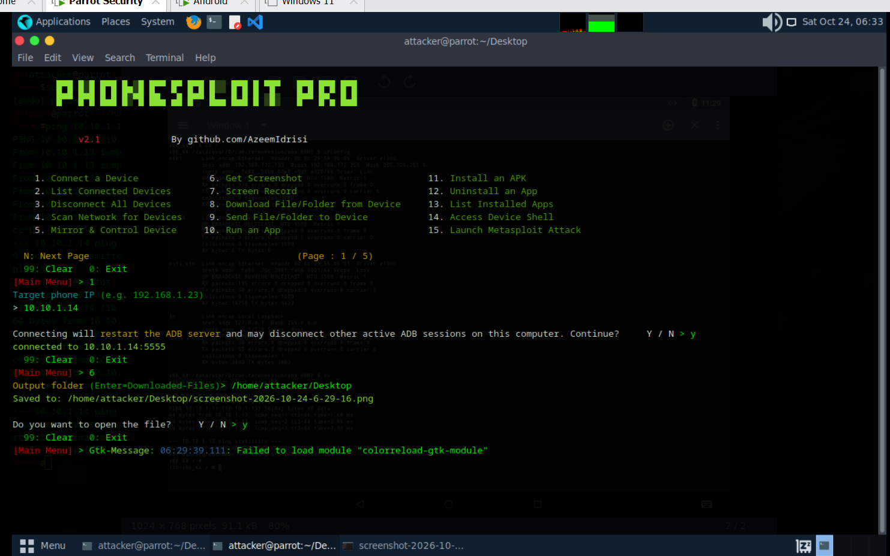
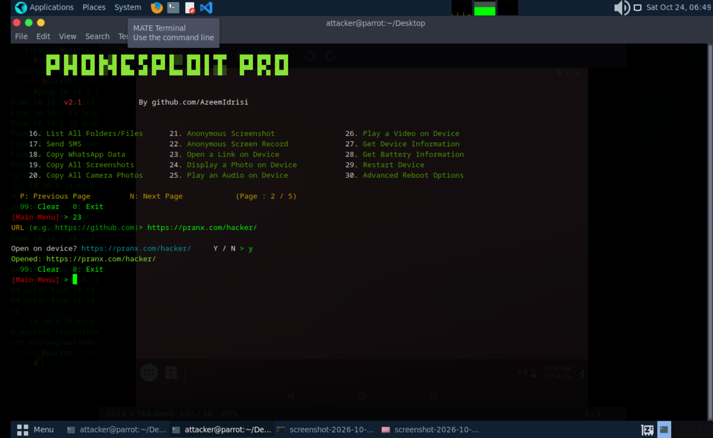

# Android Device Control via ADB — PhoneSploit Pro Walkthrough

A hands-on lab demo showing how [PhoneSploit Pro](https://github.com/AzeemIdrisi) can be used to take remote control of an Android device over ADB (Android Debug Bridge) once debugging access has been established — covering device enumeration, app management, screenshot capture, remote shell access, and more.

> ⚠️ **Disclaimer:** This walkthrough was performed entirely in a personal lab against a device I own and control (an Android emulator running on a Parrot Security VM). It's intended for educational purposes to understand how ADB-based post-access tooling works and how to defend against it (e.g., disabling USB/wireless debugging, not trusting unknown RSA keys). Do not run these steps against a device you do not own or have explicit written authorization to test.

---

## Lab Setup

| Component | Details |
|---|---|
| Attacker machine | Parrot Security OS |
| Target | Android device/emulator (`10.10.1.14`) |
| Access vector | ADB (Android Debug Bridge) over network |
| Primary tool | PhoneSploit Pro v2.1 |

---

## 1. Establishing a Network Connection to the Target

Before connecting with PhoneSploit, basic network reachability and interface configuration were confirmed on the target (`ifconfig`, assigning an IP to `eth1`, and a ping test to the attacker host).

---

## 2. Connecting PhoneSploit Pro to the Device

PhoneSploit Pro was launched and pointed at the target's IP address (`10.10.1.14`). Connecting restarts the local ADB server and establishes a session on port `5555`.

The main menu exposes a wide range of post-access actions, grouped across multiple pages — device control (screenshot, screen record, mirroring), file transfer, app management, and remote shell access.

---

## 3. Pulling a Screenshot from the Device

Using the **Get Screenshot** option, a live screenshot was pulled from the target device and saved locally to the attacker machine.

---

## 4. Listing Installed Applications

The **List Installed Apps** option was used to enumerate every package installed on the device, confirming the presence of standard AOSP packages (`com.android.calculator2`, `com.android.settings`, `com.android.systemui`, etc.) alongside the emulator's custom packages.

---

## 5. Launching an Application Remotely

With the package name known, the **Run an App** option was used to launch the Calculator app (`com.android.calculator2`) directly on the target device — confirmed both in the terminal output and on the device screen.

---

## 6. Dropping into an Interactive ADB Shell

Selecting **Access Device Shell** opens a full interactive shell on the device. From here, standard Linux-style navigation (`pwd`, `ls`, `cd`) was used to browse the filesystem, confirming access to `sdcard/Download` and recovering the previously-saved screenshots.

---

## 7. Opening a URL on the Target Device

Using the **Open a Link on Device** option, a URL (`https://pranx.com/hacker/`) was pushed to and opened remotely in the device's browser without any interaction on the device itself.

---

## Key Takeaways

- **ADB with debugging enabled over the network is a serious attack surface.** Once a device exposes ADB (especially wirelessly on port `5555`), an attacker on the same network can gain near-complete remote control without any further exploitation.
- PhoneSploit Pro wraps native `adb` commands into a menu-driven interface, lowering the barrier for screenshotting, file exfiltration, app management, and shell access.
- **Mitigations:**
  - Keep USB/Wireless debugging disabled unless actively needed.
  - Never approve an unrecognized RSA key fingerprint prompt.
  - Avoid exposing ADB over untrusted networks.
  - Use MDM policies to lock down debugging settings on managed/corporate devices.

---

## Tools Referenced

- [PhoneSploit Pro](https://github.com/AzeemIdrisi/PhoneSploit-Pro) — ADB-based Android device exploitation framework
- Android Debug Bridge (`adb`)
- Parrot Security OS
