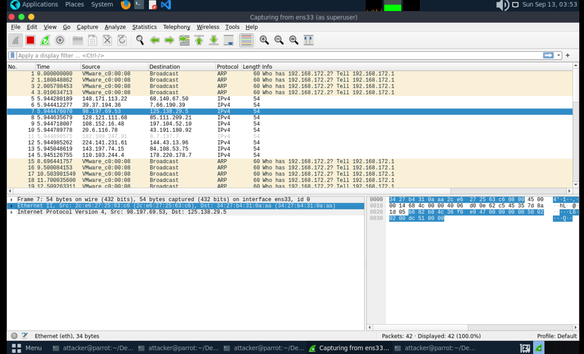

# MAC Flooding Attack (CAM Table Overflow) with `macof`

A short lab demonstrating a classic Layer 2 attack — flooding a switch's CAM (Content Addressable Memory) table with bogus MAC addresses using `macof`, and observing the resulting traffic in Wireshark.

> ⚠️ **Disclaimer:** Performed entirely in an isolated lab environment (Parrot Security VM, interface `ens33`) that I own and control. MAC flooding can disrupt network switches by forcing them into fail-open/hub-like behavior, which can be disruptive on real networks. Do not run this against any network you do not own or have explicit written authorization to test.

---

## Lab Environment

| Component | Details |
|---|---|
| Attacker machine | Parrot Security OS |
| Interface | `ens33` |
| Capture tool | Wireshark |
| Attack tool | `macof` (part of the `dsniff` suite) |

---

## 1. Baseline Traffic Capture

Before launching the attack, a Wireshark capture was started on `ens33` to establish a baseline of normal traffic — mostly ARP broadcasts and ordinary IPv4 packets.



---

## 2. Launching the MAC Flood with `macof`

With the capture running, `macof` was used to flood the local segment with a burst of packets, each carrying a randomized source MAC address and spoofed source/destination IP pairs:

```
macof -i ens33 -n 10
```

The tool rapidly generated forged Ethernet frames with random source MACs (e.g. `1d:f5:6c:65:d3:da`, `e0:8b:90:19:6e:9a`, `2c:e6:27:25:63:c6`...) — each one a distinct, fabricated entry that a connected switch would attempt to learn and store in its CAM table.


---

## How This Attack Works

A network switch maintains a CAM table mapping MAC addresses to physical ports so it can forward frames intelligently instead of broadcasting everything. That table has finite memory. `macof` exploits this by generating a high volume of frames with random, never-before-seen source MAC addresses in a very short time.

If a real switch's CAM table fills up under this flood, many switches **fail open** — falling back to broadcasting all traffic out every port, just like a hub. At that point, an attacker on the same segment can passively sniff traffic that would normally be isolated to other switch ports, turning a flood attack into a traffic-interception opportunity.

---

## Key Takeaways / Mitigations

- **Port Security** — configure switches to limit the number of MAC addresses learned per port (e.g. Cisco `switchport port-security maximum`), and shut down or restrict ports that exceed the limit.
- **Dynamic ARP Inspection (DAI) / DHCP Snooping** — helps prevent associated spoofing techniques often paired with CAM table attacks.
- **802.1X Port-Based Authentication** — ensures only authenticated devices can send traffic on a switch port in the first place.
- **Monitor for abnormal MAC learning rates** — a sudden spike in new MAC addresses on a single port is a strong signal of a flooding attempt and should trigger alerting.

---

## Tools Referenced

- [Wireshark](https://www.wireshark.org/)
- [dsniff / macof](https://www.monkey.org/~dugsong/dsniff/) — Layer 2 MAC flooding tool
